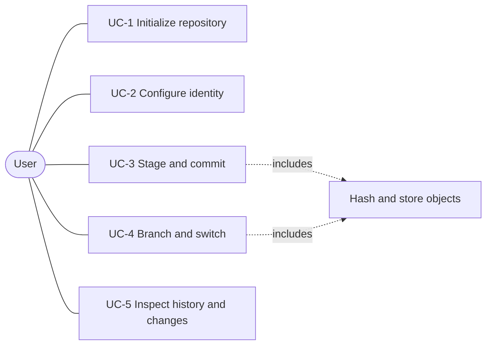

# Software Requirements Specification

## BTS: A Lightweight Version Control System

**Version 0.3 · November 2026**
**Authors:** Bharat, Tejasv, Sarthak

Priority key: **E** = Essential, **D** = Desirable, **O** = Optional.

---

## Revision History

| Version | Date | Author(s) | Description |
|---|---|---|---|
| 0.1 | Nov 2026 | Bharat, Tejasv, Sarthak | Initial draft |
| 0.2 | Nov 2026 | Bharat, Tejasv, Sarthak | Added priorities, error and configuration requirements, edge cases, full traceability matrix, appendices |
| 0.3 | Nov 2026 | Bharat, Tejasv, Sarthak | Added problem statement, use cases, detached-HEAD and unborn-branch behavior, resolved prefix length and performance targets, aligned versioning requirement with formats, consolidated into one document |

---

## 1. Introduction

### 1.1 Purpose and Problem Statement

This document specifies the requirements for **bts**, a command-line version control system that tracks changes to a directory of files, stores snapshots, and supports branching.

**Problem addressed.** Professional tools such as Git are powerful but large, and their internals are difficult for students and small teams to inspect. Learners often use Git without understanding how snapshots, hashing, and branches work. bts addresses this by providing a small, fully specified, content-addressed version control tool with a documented on-disk format (Appendices A and B), predictable behavior, and a modular codebase that can be read and extended. It is intended for:

- students learning how version control works internally, and
- individuals or small teams who need local snapshot history for small projects without a large toolchain.

This SRS is intended for the project team, the course evaluators, and future maintainers.

### 1.2 Scope

bts provides local, single-user version control: initializing a repository, staging files, committing snapshots, viewing history, working with branches, switching between commits and branches, and viewing line-based differences.

**Excluded capabilities:** remote operations and any network communication, merging, rebase, stash, tags, ignore files, packfiles, and garbage collection (see 2.6).

### 1.3 Definitions, Acronyms, and Abbreviations

| Term | Definition |
|---|---|
| BTS | Project name, derived from the authors' first names (Bharat, Tejasv, Sarthak). |
| Repository | A working directory containing a `.bts/` directory that holds all version data. |
| Object | An immutable, content-addressed record stored in `.bts/objects/`: a blob, tree, or commit. |
| Blob | An object holding the contents of one file. |
| Tree | An object listing the entries (files and subdirectories) of one directory. |
| Commit | An object recording a root tree, zero or more parents, author, timestamp, and message. |
| Index | The staging area: a file listing the paths and hashes to be included in the next commit. |
| HEAD | A pointer to the current position: either a branch reference or, when detached, a commit hash. |
| Detached HEAD | A state in which HEAD contains a commit hash directly instead of a branch reference. |
| Unborn branch | A branch that HEAD references but whose ref file does not yet exist because no commit has been made. |
| Working tree | The files in the repository directory outside `.bts/`. |
| SHA-256 | The 256-bit hash function used to identify objects. |

### 1.4 References

- IEEE Std 830-1998, Recommended Practice for Software Requirements Specifications
- zlib compression library documentation
- FIPS PUB 180-4, Secure Hash Standard
- E. Myers, "An O(ND) Difference Algorithm and Its Variations", 1986

### 1.5 Overview

The remainder of this specification is organized into four sections and appendices. Section 2 covers product context, functions, users, constraints, and apportioning of requirements. Section 3 gives specific requirements: interfaces, functional, non-functional, and data requirements. Section 4 defines the verification and traceability matrix. Appendices give the object and index formats, maintenance notes, and the companion deliverables.

---

## 2. Overall Description

### 2.1 Product Perspective

bts is a standalone command-line tool inspired by the design of Git but simpler, and not compatible with it.

**System interfaces:** bts has no interface to other software systems. It depends only on the operating system's filesystem API and standard library (SHA-256, zlib).

**Operations:** The tool is invoked interactively or from shell scripts. It runs as a short-lived process per command, holds no state between invocations other than the contents of `.bts/`, and requires no installation beyond placing the executable on `PATH`.

**Site adaptation:** Repository-specific settings (author name, author email) are stored in `.bts/config`.

### 2.2 Product Functions

- Initialize a repository
- Configure author identity
- Stage files and directories
- Report working tree status
- Commit staged changes
- Create, list, and delete branches
- Check out branches and individual commits
- Show commit history
- Show line-based differences between the working tree and the index

### 2.3 User Characteristics and Stakeholders

| Stakeholder | Description | Interest |
|---|---|---|
| Student learner | Comfortable with a command line; learning version control concepts | Clear behavior and inspectable on-disk formats |
| Individual developer or small team member | Needs local history for small projects | Reliable snapshots and safe checkout |
| Maintainer / future contributor | Extends or fixes bts | Modular code, tests, and documented formats |
| Course evaluators | Assess the project against course criteria | Traceable, verifiable requirements |

Users are assumed to be familiar with a command-line shell and basic file operations. No prior Git knowledge is assumed.

### 2.4 General Constraints

- **Regulatory:** None. The project is academic and handles no personal data beyond the author name and email entered by the user.
- **Language and toolchain:** bts shall be implemented in C++17 and built with CMake and a GCC or Clang compiler on Linux and macOS. It shall use `std::filesystem` for path handling, zlib for compression, and OpenSSL libcrypto (EVP interface) for SHA-256. Unit tests shall use GoogleTest and run through CTest. The built executable shall not require network access at runtime.
- **Concurrency:** bts is a single-user, single-process tool. Concurrent invocations on the same repository are unsupported, but shall be detected where practical using a lock file (`.bts/index.lock`, see RR-3).

### 2.5 Assumptions and Dependencies

The build environment provides a C++17 compiler, CMake 3.16 or later, and development headers for zlib and OpenSSL. These are build-time and link-time dependencies only; no other runtime services are needed. The user's filesystem supports POSIX-style permissions and symbolic links.

### 2.6 Apportioning of Requirements

The following are deferred to future versions and are not part of this specification: merge and merge-conflict resolution, rebase, stash, tags, `.btsignore` patterns, packfiles and delta compression, garbage collection of unreachable objects, staged diff (`bts diff --cached`), file removal and rename commands (`bts rm`, `bts mv`), and remote operations.

---

## 3. Specific Requirements

### 3.1 External Interface Requirements

#### 3.1.1 CLI Syntax

```
bts init
bts config <user.name | user.email> [<value>]
bts add <path ...>
bts status
bts commit -m "<message>"
bts branch [<name>]
bts branch -d <name>
bts checkout <branch-name | commit-hash>
bts log [--oneline]
bts diff
```

**Exit statuses:** 0 success; 1 general failure; 2 usage error; 3 integrity error.

#### 3.1.2 File System Interface

A repository has the following layout:

```
<repo>/
  .bts/
    HEAD            "ref: refs/heads/<name>" or a 64-character commit hash
    config          author name and email
    index           staging area (Appendix B)
    objects/xx/yyyy...   zlib-compressed objects (Appendix A)
    refs/heads/<name>    one file per branch, containing a commit hash
```

#### 3.1.3 Communications Interfaces

Not applicable. bts performs no network communication (see Section 1.2).

#### 3.1.4 Memory Interfaces

As a design guideline, bts should process objects as streams or bounded buffers where practical, so that peak memory use stays close to the size of the largest single file being hashed. The line-diff algorithm may use additional memory proportional to the lengths of the compared files. No minimum primary-memory size is mandated, and this guideline is not verified by a test.

### 3.2 Functional Requirements

#### 3.2.1 Use Cases

| ID | Use case | Actor | Requirements |
|---|---|---|---|
| UC-1 | Initialize a repository | User | REQ-INIT-1, REQ-INIT-2, REQ-ERR-1 |
| UC-2 | Configure identity | User | REQ-CFG-1, REQ-CFG-2, REQ-CFG-3 |
| UC-3 | Stage and commit changes | User | REQ-OBJ-1 to REQ-OBJ-4, REQ-ADD-1 to REQ-ADD-7, REQ-STAT-1 to REQ-STAT-3, REQ-CMT-1 to REQ-CMT-5 |
| UC-4 | Branch and switch | User | REQ-BRN-1 to REQ-BRN-5, REQ-CHK-1 to REQ-CHK-4 |
| UC-5 | Inspect history and changes | User | REQ-LOG-1 to REQ-LOG-4, REQ-DIF-1 to REQ-DIF-3, REQ-STAT-1 |



A formal UML use-case diagram, with the same actors and use cases, belongs in the modelling document (Appendix D).

#### 3.2.2 Repository Initialization

| ID | Requirement | Pri. | Rationale |
|---|---|---|---|
| REQ-INIT-1 | `bts init` shall create `.bts/` containing `objects/`, `refs/heads/`, an empty `index`, and a HEAD file containing `ref: refs/heads/main`. | E | Establishes the repository structure. |
| REQ-INIT-2 | If `.bts/` already exists, `bts init` shall exit non-zero with an already-initialized error and shall not modify any existing file. | E | Prevents data loss. |

#### 3.2.3 Object Storage

| ID | Requirement | Pri. | Rationale |
|---|---|---|---|
| REQ-OBJ-1 | Every object shall be serialized as a header `<type> <size>\0` followed by the payload, where type is `blob`, `tree`, or `commit` (Appendix A). | E | Uniform format. |
| REQ-OBJ-2 | The object ID shall be the SHA-256 digest of the header and payload, written as 64 lowercase hexadecimal characters. | E | Content addressing. |
| REQ-OBJ-3 | The system shall store each object zlib-compressed (level 1) at `.bts/objects/<first 2 hex characters>/<remaining 62 hex characters>`. | E | Storage layout; level 1 chosen for speed (see PR-1). |
| REQ-OBJ-4 | Upon reading any object, the system shall decompress it, recompute SHA-256 over the header and payload, and verify that the digest equals the 64-character hash derived from the object's path. On mismatch the system shall abort with an integrity error (see REQ-ERR-3). | E | Detects disk corruption and tampering. |

#### 3.2.4 Staging

| ID | Requirement | Pri. | Rationale |
|---|---|---|---|
| REQ-ADD-1 | `bts add <path>` shall read the contents of the file at `<path>`, wrap them in a blob header per REQ-OBJ-1, compute the hash per REQ-OBJ-2, write the blob per REQ-OBJ-3 (skipping the write if the object already exists), and add or update the matching index entry. | E | Stages file contents. |
| REQ-ADD-2 | Each index entry shall record mode, modification time (seconds and nanoseconds), file size, SHA-256, and path (Appendix B). | E | Supports status and the stat cache. |
| REQ-ADD-3 | If `<path>` is a directory, `bts add` shall stage every regular file and symbolic link beneath it recursively. | E | Convenient staging. |
| REQ-ADD-4 | The index and tree entries shall record file mode as either regular (100644) or executable (100755), based on the owner execute bit. | D | Restores the executable bit on checkout. |
| REQ-ADD-5 | Symbolic links shall be stored as blobs whose content is the link target, with mode 120000, and shall not be followed. | O | Avoids infinite traversal. |
| REQ-ADD-6 | Empty directories shall not be tracked. A path that does not exist shall cause `bts add` to fail with an error without altering the index. | E | Trees cannot represent empty directories under this design. |
| REQ-ADD-7 | The directory `.bts/` shall never be staged or traversed. | E | Prevents recursive self-inclusion. |

#### 3.2.5 Status

| ID | Requirement | Pri. | Rationale |
|---|---|---|---|
| REQ-STAT-1 | `bts status` shall report three categories: staged changes (index differs from HEAD), unstaged changes (working tree differs from index), and untracked files. | E | Core inspection. |
| REQ-STAT-2 | When a tracked file's mtime and size match its index entry, `bts status` shall treat it as unchanged without re-hashing it. | E | Performance (see PR-2). |
| REQ-STAT-3 | In an unborn-branch state, `bts status` shall print a "no commits yet" notice, treat HEAD as an empty tree, and list staged and untracked files normally. | D | Defined behavior for a fresh repository. |

#### 3.2.6 Commit

| ID | Requirement | Pri. | Rationale |
|---|---|---|---|
| REQ-CMT-1 | `bts commit` shall fail without creating a commit if the index tree equals the tree of the HEAD commit, or, in an unborn-branch state, if the index is empty. | E | Rejects empty commits. |
| REQ-CMT-2 | The system shall build one tree object per directory from the index, nested to form the root tree. | E | Snapshot structure. |
| REQ-CMT-3 | The commit object shall record the root tree, the parent (none for the first commit), the author from `.bts/config`, a timestamp with timezone, and the message. | E | Commit data. |
| REQ-CMT-4 | After writing the commit object, the system shall update the current branch ref atomically (write a temporary file, then rename), creating the ref file if the branch is unborn. | E | Crash safety. |
| REQ-CMT-5 | If HEAD is detached, `bts commit` shall be permitted: it shall write the new commit with the HEAD commit as parent, update HEAD to the new full hash, and print a warning that the commit is not on any branch. | D | Defined behavior for detached state. |

#### 3.2.7 History

| ID | Requirement | Pri. | Rationale |
|---|---|---|---|
| REQ-LOG-1 | `bts log` shall start at the HEAD commit (resolved through the branch if HEAD is a reference) and follow parent links to the root, printing commits newest-first. | E | Basic history. |
| REQ-LOG-2 | With `--oneline`, each line shall show an abbreviated hash and the first line of the message. | E | Compact output. |
| REQ-LOG-3 | Abbreviated hashes shall be 7 characters by default. If a 7-character prefix is ambiguous among reachable commits, it shall be lengthened until unique. | D | Handles prefix collisions. |
| REQ-LOG-4 | In an unborn-branch state, `bts log` shall print an error that no commits exist and exit with a non-zero status. | D | Defined behavior. |

#### 3.2.8 Branching

| ID | Requirement | Pri. | Rationale |
|---|---|---|---|
| REQ-BRN-1 | `bts branch` with no arguments shall list all branches, marking the current branch with `*`. In a detached state no branch is marked. | E | Listing. |
| REQ-BRN-2 | `bts branch <name>` shall create `.bts/refs/heads/<name>` containing the HEAD commit hash (also when HEAD is detached) and shall not change the working tree or HEAD. | E | Branch creation. |
| REQ-BRN-3 | `bts branch -d <name>` shall delete `.bts/refs/heads/<name>`. It shall refuse to delete the branch HEAD currently references and shall report an error if the branch does not exist. | E | Listed in Product Functions (2.2). |
| REQ-BRN-4 | Branch names shall be non-empty and shall not contain whitespace, `..`, `~`, `^`, `:`, a backslash, a leading `-` or `/`, a trailing `/` or `.lock`, or control characters. `bts branch <name>` shall fail if the name is invalid or already exists. | E | Prevents ref-path escapes and overwrites. |
| REQ-BRN-5 | In an unborn-branch state, `bts branch` with no arguments shall list no branches, and `bts branch <name>` shall fail with an error stating that no commits exist yet. | D | Defined behavior for a fresh repository. |

#### 3.2.9 Checkout

| ID | Requirement | Pri. | Rationale |
|---|---|---|---|
| REQ-CHK-1 | `bts checkout <branch-name>` shall set HEAD to `ref: refs/heads/<branch-name>`, replace the index with the contents of the target commit's root tree, and update the working tree to match. | E | Branch switching. |
| REQ-CHK-2 | If the index or working tree contains uncommitted changes, or untracked files, that checkout would overwrite, the system shall abort without modifying any file and instruct the user to commit or discard those changes. | E | Prevents data loss. |
| REQ-CHK-3 | `bts checkout <commit-hash>` shall resolve the hash (the full 64 characters, or an unambiguous prefix of at least 4 characters), write the full hash into HEAD (detached state), and update the index and working tree per REQ-CHK-1. It shall print a notice that HEAD is detached. An ambiguous prefix shall fail with an error listing the candidates. | E | Required by the CLI syntax and the HEAD definition. |
| REQ-CHK-4 | If the checkout target matches neither a branch nor an existing commit, checkout shall fail without modifying any file. | E | Error handling. |

A name that matches both a branch and a commit prefix shall be resolved as the branch.

#### 3.2.10 Diff

| ID | Requirement | Pri. | Rationale |
|---|---|---|---|
| REQ-DIF-1 | `bts diff` shall compute line-based differences using a Myers or LCS algorithm between each tracked working-tree file and its staged index version. Comparison of the index against HEAD (`--cached`) is out of scope (see 2.6). | E | Defines diff scope. |
| REQ-DIF-2 | Output shall use unified diff format with `---` and `+++` headers and `@@ -s,l +s,l @@` chunk headers. | E | Standard, readable format. |
| REQ-DIF-3 | If either version of a file contains a NUL byte, `bts diff` shall print `Binary files differ` instead of a line diff. | D | Avoids unreadable output. |

#### 3.2.11 Configuration

| ID | Requirement | Pri. | Rationale |
|---|---|---|---|
| REQ-CFG-1 | `bts config user.name <value>` and `bts config user.email <value>` shall store the value in `.bts/config`; with no value they shall print the stored value. | E | REQ-CMT-3 needs an author identity source. |
| REQ-CFG-2 | If user.name or user.email is unset, `bts commit` shall fail with a message naming the missing key and shall create no objects. | E | Prevents commits with empty authorship. |
| REQ-CFG-3 | `bts config` with any key other than `user.name` or `user.email` shall exit with status 2 and list the supported keys. | D | Defined behavior for bad input. |

#### 3.2.12 Error Handling

| ID | Requirement | Pri. | Rationale |
|---|---|---|---|
| REQ-ERR-1 | Any command other than `init` run outside a repository shall exit non-zero with the message `not a bts repository`. The tool shall search parent directories for `.bts/` before reporting this error. | E | Standard behavior. |
| REQ-ERR-2 | An unknown subcommand or malformed arguments shall print a usage summary to standard error and exit with status 2. | E | Predictable scripting behavior. |
| REQ-ERR-3 | Integrity errors (REQ-OBJ-4 and index footer mismatch) shall exit with status 3 and name the offending object hash or file. | E | Distinguishes corruption from user error. |
| REQ-ERR-4 | Every other failure (for example a missing path, invalid branch name, refused checkout, or missing identity) shall exit with status 1. | E | Complete exit status contract. |

### 3.3 Non-Functional Requirements

#### 3.3.1 Performance

| ID | Requirement | Pri. | Rationale |
|---|---|---|---|
| PR-1 | On a reference machine (to be stated in the test report: CPU model, core count, RAM, OS version, warm filesystem cache), staging and committing 1,000 files totalling under 50 MB shall complete within **3 seconds** at zlib level 1. | D | Confirmed: Release 3-trial benchmark measured **0.232 s** median (`0.244 s` max, `1,000` files, `19.53 MiB`) on Apple M5 Pro (`arm64`, 15 cores, 48.0 GB RAM, macOS 27.0). See [test-plan-and-report.md](test-plan-and-report.md). |
| PR-2 | On the same reference machine, `bts status` on a clean repository of up to 5,000 files shall complete within **200 ms**, relying on the stat cache per REQ-STAT-2. | D | Confirmed: Release 3-trial benchmark measured **40.3 ms** median (`40.6 ms` max, `5,000` clean files, `0` blob re-hashes) on the same reference machine. See [test-plan-and-report.md](test-plan-and-report.md). |

#### 3.3.2 Reliability

| ID | Requirement | Pri. |
|---|---|---|
| RR-1 | Writes to the index and to refs shall be atomic: write to a temporary file, then rename over the target. A crash shall leave the previous data readable and valid. | E |
| RR-2 | A hash mismatch on an object read shall be fatal and shall stop all further processing of that command. | E |
| RR-3 | Before mutating the index or any ref, the system shall create a lock file (`.bts/index.lock` or `<ref>.lock`) using exclusive creation. If it already exists, the system shall abort with an error and leave existing data untouched. The lock is removed on completion. | D |

#### 3.3.3 Portability

| ID | Requirement | Pri. |
|---|---|---|
| PO-1 | All stored paths (tree entries and index entries) shall use `/` as separator. | E |
| PO-2 | A repository created on Linux shall be readable on macOS and vice versa. | E |

#### 3.3.4 Security

| ID | Requirement | Pri. | Rationale |
|---|---|---|---|
| SR-1 | The system shall never modify or delete an existing object file. Newly written object files shall be created with permission mode 0444. | E | File permissions discourage accidental change but do not guarantee immutability; REQ-OBJ-4 detects tampering. |

#### 3.3.5 Maintainability

| ID | Requirement | Pri. |
|---|---|---|
| MNT-1 | The codebase shall be organized into separate modules for object storage, index, refs, and command handling, with no module reading `.bts/` files owned by another. | D |
| MNT-2 | Each module shall have unit tests, and the automated test suite shall be runnable with a single documented command. | E |
| MNT-3 | The index file format shall carry a version field (Appendix B) so that future versions can detect an unsupported format. Object formats are identified by their type header and are not versioned. | O |

#### 3.3.6 Usability

| ID | Requirement | Pri. |
|---|---|---|
| USR-1 | Every error message shall go to standard error, state what failed, and, where possible, suggest a corrective action. | D |

### 3.4 Data Requirements

All persistent data lives under `.bts/`. Objects follow Appendix A, the index follows Appendix B, branch refs are text files containing a 64-character hash and a newline, and `config` is a plain-text key-value file. No other persistent data is kept.

---

## 4. Verification and Traceability Matrix

Method key: **UT** unit test, **FT** functional test, **IT** integration test, **BT** boundary test, **ST** stress or fault injection, **PT** performance test, **IN** inspection.

| Req ID | Requirement summary | Pri. | Method | Pass criteria |
|---|---|---|---|---|
| REQ-INIT-1 | Create empty repository structure | E | FT | `objects/`, `refs/heads/`, `index`, and HEAD (`ref: refs/heads/main`) exist. |
| REQ-INIT-2 | Refuse re-initialization | E | FT | Second `init` exits non-zero, prints already-initialized error, and file checksums in `.bts/` are unchanged. |
| REQ-OBJ-1 | Object header format | E | UT | Serialized bytes begin with `<type> <size>\0`. |
| REQ-OBJ-2 | SHA-256 object ID | E | UT | Known input yields the expected 64-hex digest. |
| REQ-OBJ-3 | zlib storage at `objects/xx/yyyy` | E | IT | File is at the correct path; decompression returns the original bytes; stored size is smaller for compressible input. |
| REQ-OBJ-4 | Integrity check on read | E | UT | A tampered object triggers an integrity error naming its hash. |
| REQ-ADD-1 | Stage file as blob and index entry | E | FT | Blob exists in `objects/`; index entry has the correct hash. |
| REQ-ADD-2 | Index entry fields | E | UT | Entry round-trips mode, mtime, size, hash, and path. |
| REQ-ADD-3 | Recursive directory staging | E | FT | Every nested file is in the index. |
| REQ-ADD-4 | Regular and executable modes | D | FT | A `chmod +x` file is recorded as 100755 and restored on checkout. |
| REQ-ADD-5 | Symlink handling | O | FT | A symlink is stored as mode 120000 with the target as content. |
| REQ-ADD-6 | Empty directory and missing path | E | BT | Empty directory stages nothing; missing path exits non-zero with the index unchanged. |
| REQ-ADD-7 | Exclude `.bts/` | E | FT | `bts add .` leaves no `.bts/` paths in the index. |
| REQ-STAT-1 | Three-category status | E | FT | Staged, unstaged, and untracked files appear under the correct heading. |
| REQ-STAT-2 | Stat-cache shortcut | E | UT | With unchanged mtime and size, no file is re-hashed (hash call counter is 0). |
| REQ-STAT-3 | Status on unborn branch | D | BT | Prints "no commits yet"; staged and untracked files are listed. |
| REQ-CMT-1 | Reject empty commit | E | FT | Commit with index equal to HEAD (or empty index on an unborn branch) exits non-zero and creates no commit. |
| REQ-CMT-2 | Build nested trees | E | IT | Root tree hash is reproducible and each subdirectory has its own tree object. |
| REQ-CMT-3 | Commit object fields | E | IT | Parsed commit has the correct tree, parent (none for the root commit), author, timestamp, and message. |
| REQ-CMT-4 | Atomic ref update | E | IT | Branch ref holds the new hash after the commit (created if unborn); no `.tmp` file remains. |
| REQ-CMT-5 | Commit in detached HEAD | D | IT | HEAD holds the new hash, the commit's parent is the previous HEAD commit, and a warning is printed. |
| REQ-LOG-1 | Traverse history to root | E | FT | Output lists commits newest-first, ending at the root; works from a detached HEAD. |
| REQ-LOG-2 | `--oneline` format | E | FT | Each line is a 7-character hash plus the first message line. |
| REQ-LOG-3 | Abbreviation uniqueness | D | UT | With two commits sharing a 7-character prefix, shown prefixes are unique. |
| REQ-LOG-4 | Log on unborn branch | D | BT | Non-zero exit and a no-commits message. |
| REQ-BRN-1 | List branches with `*` | E | FT | Exactly one branch is starred, the current one; none when detached. |
| REQ-BRN-2 | Create branch at HEAD | E | FT | New ref contains the HEAD commit hash (also when detached); the working tree is unchanged. |
| REQ-BRN-3 | Delete branch | E | FT | Ref file is removed; deleting the current or a missing branch fails. |
| REQ-BRN-4 | Branch name validation | E | BT | Each invalid name in the rule list is rejected, and duplicates are refused. |
| REQ-BRN-5 | Branch ops on unborn branch | D | BT | List is empty; create fails with a clear error. |
| REQ-CHK-1 | Checkout branch | E | IT | HEAD, index, and working tree match the target commit. |
| REQ-CHK-2 | Overwrite protection | E | BT | Aborts with non-zero exit when unstaged edits or untracked files collide with target files; no files are changed. |
| REQ-CHK-3 | Detached checkout | E | IT | HEAD contains the full commit hash and a detached notice is printed; a 4-character unambiguous prefix works, a 3-character prefix is rejected, and an ambiguous prefix fails. |
| REQ-CHK-4 | Unknown checkout target | E | BT | Non-zero exit and no files modified. |
| REQ-DIF-1 | Line diff of working tree vs index | E | UT | Output matches reference diff results on a set of test inputs. |
| REQ-DIF-2 | Unified diff format | E | FT | Output has `---`/`+++` headers and correct `@@ -s,l +s,l @@` chunk headers. |
| REQ-DIF-3 | Binary file handling | D | FT | NUL-containing file prints `Binary files differ`. |
| REQ-CFG-1 | Set and get config | E | FT | Value persists in `.bts/config` and is printed back. |
| REQ-CFG-2 | Commit requires identity | E | FT | Commit fails naming the missing key; the object count is unchanged. |
| REQ-CFG-3 | Unsupported config key | D | FT | Exit status 2 and the supported keys are listed. |
| REQ-ERR-1 | Outside-repository error | E | FT | Exit non-zero with `not a bts repository`; works from a subdirectory of a repo. |
| REQ-ERR-2 | Usage error | E | FT | Exit status 2 and a usage message on stderr. |
| REQ-ERR-3 | Integrity error status | E | FT | Corrupted object or index yields exit status 3 and the offending hash or file. |
| REQ-ERR-4 | General failure status | E | FT | Missing path, invalid branch name, and refused checkout each exit with status 1. |
| PR-1 | Stage and commit 1,000 files | D | PT | Completes within 3 s on the documented reference machine at zlib level 1. |
| PR-2 | Status on 5,000 files | D | PT | Completes within 200 ms on a clean repository on the documented reference machine. |
| RR-1 | Atomic writes | E | ST | Killing the process with SIGKILL mid-commit leaves the prior refs and index readable and valid. |
| RR-2 | Hash mismatch is fatal | E | UT | Corrupted object prevents further processing. |
| RR-3 | Lock files | D | FT | A pre-existing lock file makes the command abort without data changes. |
| PO-1 | POSIX separators | E | UT | All stored paths use `/` only. |
| PO-2 | Cross-platform readability | E | IT | A repository created on Linux passes `log` and `status` on macOS, and vice versa. |
| SR-1 | Immutable object files | E | IT | New objects have mode 0444, and no code path rewrites an existing object (verified by test and code inspection). |
| MNT-1 | Modular code structure | D | IN | Review confirms the module boundaries. |
| MNT-2 | Unit tests and one-command run | E | IN | Single documented command runs the suite and passes. |
| MNT-3 | Versioned index format | O | IN | Index header carries a version field. |
| USR-1 | Actionable errors on stderr | D | IN | Sampled error messages go to stderr and state a cause. |

---

## Appendix A: Object Format

```
blob   : "blob <n>\0" + <n bytes of file content>
tree   : "tree <n>\0" + repeated entries: "<mode> <name>\0" + <32-byte raw SHA-256>
commit : "commit <n>\0" + text:
         tree <64-hex>
         parent <64-hex>        (zero or more lines)
         author <name> <<email>> <epoch> <tz>

         <message>
```

Tree entries shall be sorted by name in byte order. The stored file is `zlib(header + payload)`; the object ID is `SHA-256(header + payload)`.

## Appendix B: Index File Layout

```
Header : magic "BTSI" | version (uint32) | entry count (uint32)
Entry  : mode (uint32) | mtime (uint64 seconds, uint32 nanoseconds)
         | file_size (uint64) | sha256 (32 bytes)
         | path length (uint16) | path (UTF-8, '/' separators)
Footer : SHA-256 checksum of all preceding bytes
```

Entries shall be sorted by path in byte order. A footer mismatch is treated as an integrity error (REQ-ERR-3).

## Appendix C: Maintenance and Extension Notes

- **Modularity (MNT-1):** each module (object store, index, refs, commands) exposes a small interface, so a module can be changed without touching the others.
- **Adding a command:** add a handler in the command module, register it in the CLI dispatcher, add requirements to Section 3.2 and rows to Section 4, and add unit and functional tests.
- **Format changes:** bump the index version (MNT-3); older versions shall fail with a clear unsupported-format error rather than misreading data.
- **Planned extensions:** the items in Section 2.6 are the intended roadmap, starting with `diff --cached`, tags, and `.btsignore`.
- **Corrective maintenance:** the integrity checks (REQ-OBJ-4, REQ-ERR-3) and the automated suite (MNT-2) are the first tools for diagnosing and preventing regressions.

## Appendix D: Companion Deliverables

The following course deliverables accompany this SRS and reference its requirement IDs:

1. Requirement analysis, stakeholder matrix, and use-case specifications: [requirement-analysis.md](requirement-analysis.md)
2. Architecture, ADRs, SQA design mapping, and UML models (use-case, class, sequence, activity, state): [architecture.md](architecture.md)
3. Test plan, traceability matrix, build instructions, and verified CTest + benchmark report (`PR-1`, `PR-2`): [test-plan-and-report.md](test-plan-and-report.md)
4. Project plan, team RACI responsibilities, milestone schedule, and risk register: [project-plan.md](project-plan.md)
5. Post-deployment software maintenance and evolution guide (ISO/IEC 14764): [maintenance.md](maintenance.md)

## Appendix E: Open Items

| # | Item | Status |
|---|---|---|
| 1 | PR-1 and PR-2 targets (3 s, 200 ms) | Done. Confirmed via `scripts/benchmark.py` 3-trial Release run (`0.232 s` / `40.3 ms` median; see [test-plan-and-report.md](test-plan-and-report.md)). |
| 2 | Implementation language | Done. C++17, CMake, zlib, OpenSSL libcrypto, GoogleTest. |
| 3 | Hash prefix length | Done. 4 characters minimum for checkout input, 7 default for output. |
| 4 | Organization of Section 3.2 | Done. Organized by feature with use cases mapped in 3.2.1. |