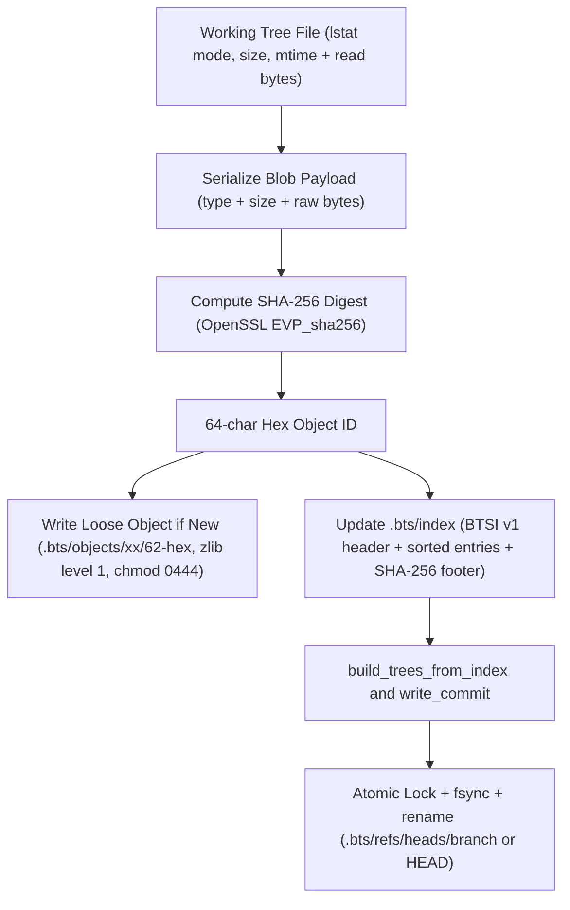
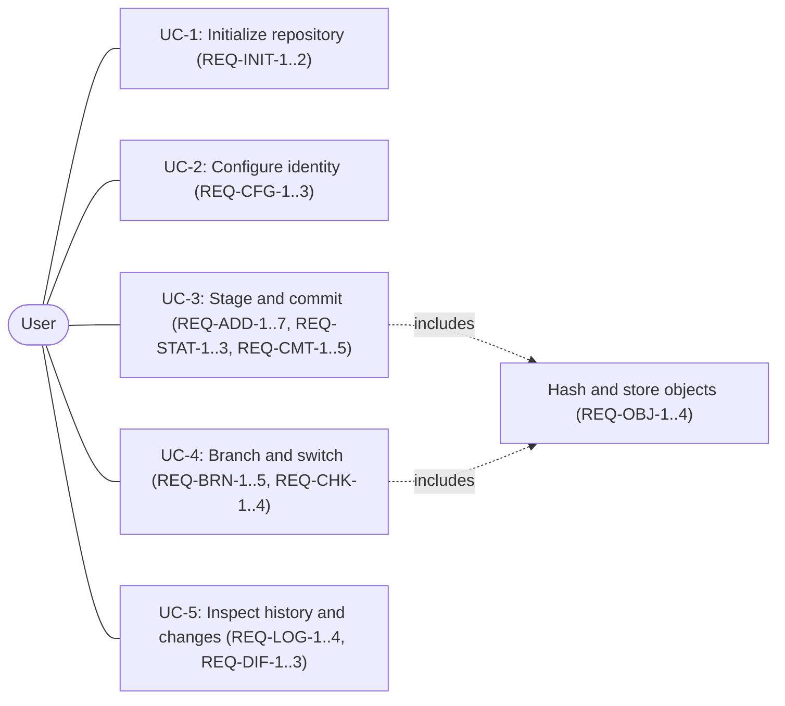
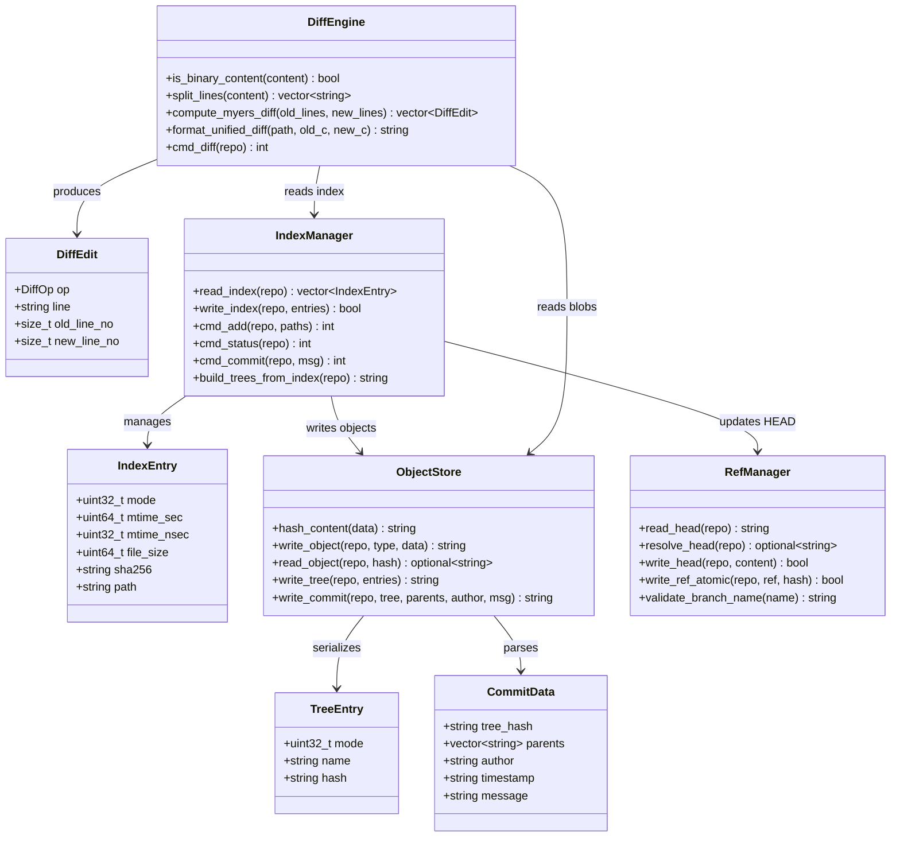
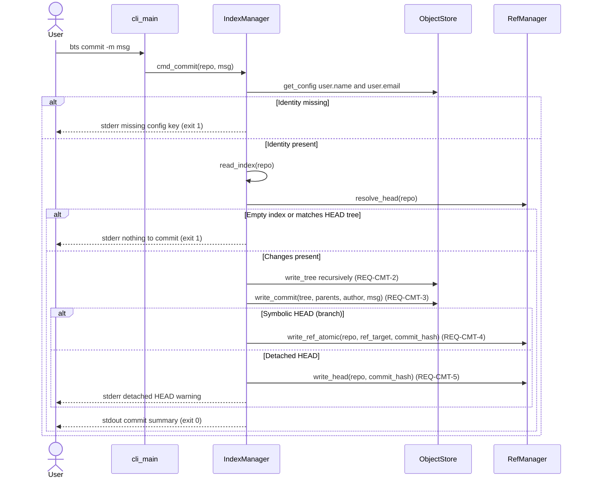
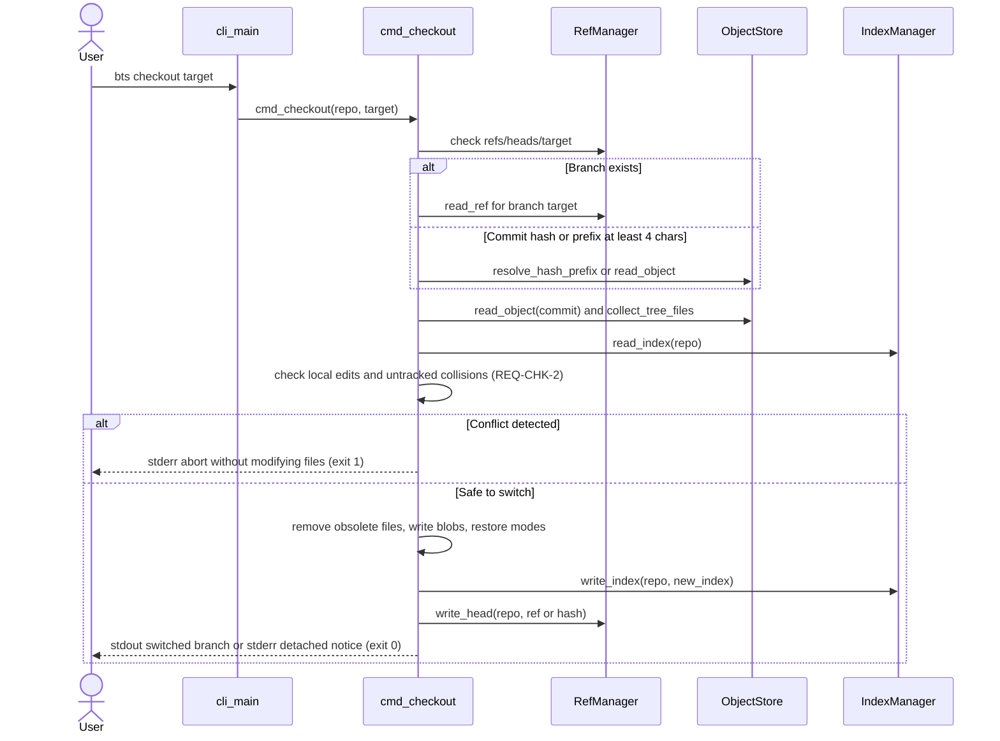
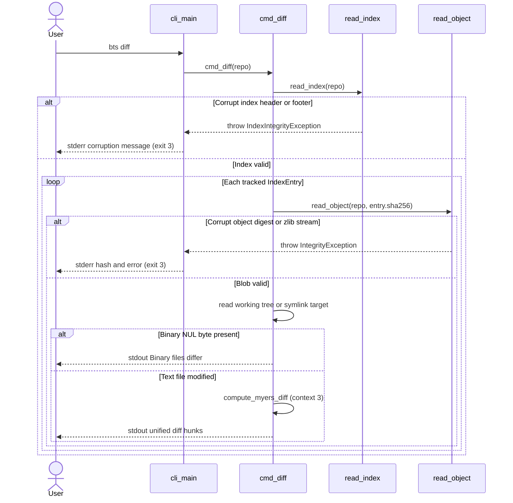
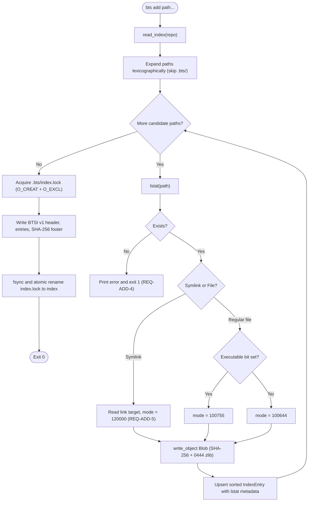
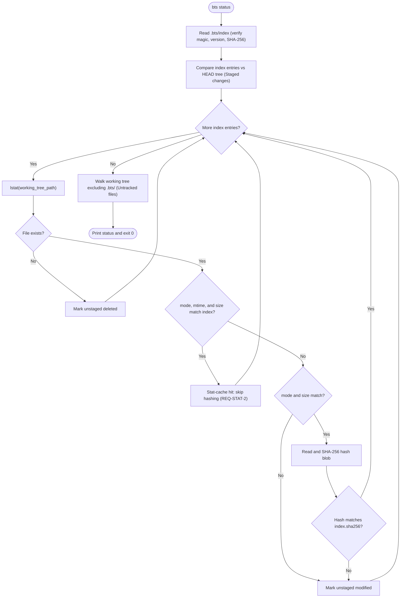
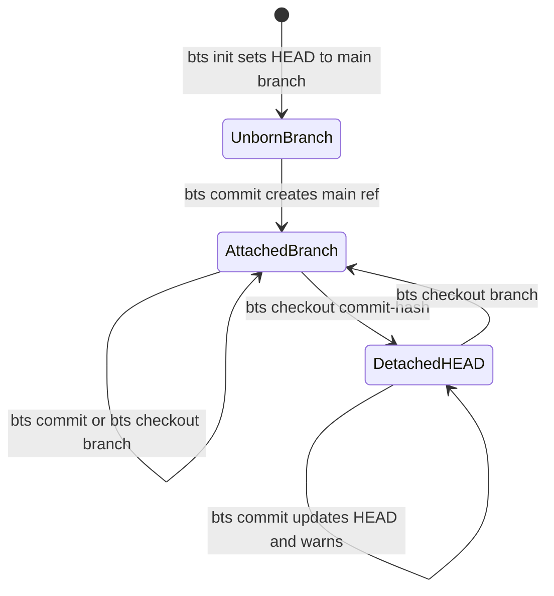

# Architecture, Design, and UML Models

This document is the companion architecture and UML specification for **bts** (referenced in [SRS.md](SRS.md) Appendix D, items 1 and 2). It traces module boundaries, design decisions, and behavioral models to the requirement IDs in [SRS.md](SRS.md).

---

## 1. Layered Architecture (`MNT-1`)

`bts` separates CLI argument parsing, command orchestration, core VCS data structures, and low-level cryptographic/compression primitives into distinct layers:

```text
Tier 1: CLI Interface          src/main.cpp, src/commands/cli.cpp
          │
Tier 2: Porcelain Commands     src/commands/branch.cpp, checkout.cpp, log.cpp
          │                    src/core/index.cpp (add, status, commit), diff.cpp
          ▼
Tier 3: Core VCS Engine
          ├── Object Store     src/include/bts/object_store.h, src/core/object_store_stub.cpp
          ├── Staging Index    src/include/bts/index.h, src/core/index.cpp
          ├── Ref Manager      src/include/bts/refs.h, src/core/refs.cpp
          └── Diff Engine      src/include/bts/diff.h, src/core/diff.cpp
          │
Tier 4: Storage & Object Model src/storage/{hash,compress,object_store}.*
                               src/objects/{blob,tree,commit}.*
```

### Module Responsibilities

| Module | Files | Owned `.bts/` State | Key Requirements |
|---|---|---|---|
| **CLI Dispatcher** | `src/main.cpp`, `src/commands/cli.cpp` | None | `REQ-ERR-1`, `REQ-ERR-2`, `REQ-ERR-3`, `REQ-ERR-4` |
| **Object Storage** | `src/include/bts/object_store.h`, `src/core/object_store_stub.cpp`, `src/storage/*`, `src/objects/*` | `.bts/objects/`, `.bts/config` | `REQ-INIT-1..2`, `REQ-OBJ-1..4`, `REQ-CFG-1..3`, `SR-1` |
| **Staging Index** | `src/include/bts/index.h`, `src/core/index.cpp` | `.bts/index`, `.bts/index.lock` | `REQ-ADD-1..7`, `REQ-STAT-1..3`, `REQ-CMT-1..5`, `MNT-3`, `RR-1`, `RR-3` |
| **Diff Engine** | `src/include/bts/diff.h`, `src/core/diff.cpp` | None (reads via Index & Object Store) | `REQ-DIF-1..3` |
| **Ref Manager** | `src/include/bts/refs.h`, `src/core/refs.cpp` | `.bts/HEAD`, `.bts/refs/heads/*` | `REQ-BRN-1..5`, `RR-1`, `RR-3` |
| **Branch / Checkout / Log** | `src/commands/{branch,checkout,log}.cpp` | None (uses Refs, Index, Object Store) | `REQ-BRN-1..5`, `REQ-CHK-1..4`, `REQ-LOG-1..4` |

---

## 2. Architecture Decision Records (ADRs)

### ADR-1: Content-Addressed SHA-256 Loose Object Store with Immutable `0444` Permissions
- **Context:** BTS requires tamper-evident storage for blobs, trees, and commits (`REQ-OBJ-1..4`, `SR-1`) without shelling out to `git`.
- **Options Considered:** (A) SHA-1 loose store (legacy Git default); (B) Packfile-only compressed archive; (C) SHA-256 loose store compressed with zlib level 1 and `0444` permissions (`OpenSSL EVP`).
- **Decision:** **Option C** — SHA-256 via `OpenSSL::Crypto` `EVP_sha256()`, zlib level 1 compression, atomic temp-file write + `fsync` + `0444` `chmod` + `rename`, and object-read re-hashing (`IntegrityException` on mismatch).
- **Consequences:** Eliminates SHA-1 collision concerns (`SR-1`), prevents accidental in-place mutation (`0444`), avoids overwriting existing content-addressed objects, and meets `PR-1` throughput (`< 0.3 s` for 1,000 files). Future packfiles remain additive.

### ADR-2: Versioned Binary Staging Index (`"BTSI"` v1) with Embedded SHA-256 Footer & `lstat` Cache
- **Context:** `bts status` must scan 5,000 clean files in `< 200 ms` (`PR-2`) while detecting index corruption (`REQ-ERR-3`) and supporting future format upgrades (`MNT-3`).
- **Options Considered:** (A) Plain-text CSV/INI index; (B) SQLite database; (C) Custom big-endian binary format `"BTSI"` with `lstat` metadata and a 32-byte trailing SHA-256 digest (`Appendix B`).
- **Decision:** **Option C** — Zero external database dependencies, deterministic sorting by POSIX `/` path (`PO-1`), explicit `uint32_t version = 1` validation (`IndexIntegrityException` on unsupported versions or checksum failure), and `mtime`/`size`/`mode` stat cache (`REQ-STAT-2`).
- **Consequences:** Enables `O(N)` single-syscall `lstat()` short-circuiting (`0` blob reads on clean status) and guaranteed fail-closed corruption detection (`exit 3`).

### ADR-3: POSIX Exclusive Lock Files (`O_CREAT | O_EXCL`) + `fsync` + Atomic `rename()`
- **Context:** Sudden process termination or concurrent writers must never leave a truncated `.bts/index` or `.bts/refs/heads/*` (`RR-1`, `RR-3`).
- **Options Considered:** (A) In-place file truncation/overwrite; (B) `flock()` advisory locking only; (C) `O_CREAT | O_EXCL` `.lock` file creation, write + `fsync`, and atomic `rename()`.
- **Decision:** **Option C** (`write_index` in `src/core/index.cpp`, `write_ref_atomic` in `src/core/refs.cpp`).
- **Consequences:** Guarantees strict single-writer mutual exclusion (`RR-3`) and preserves valid pre-crash state under `SIGKILL` (verified in `SystemE2ETest.FaultInjection_SigkillPreservesConsistentRepoState`). Orphaned locks require documented manual removal after abnormal termination.

### ADR-4: Myers $O(ND)$ Shortest-Edit-Script Line Diff
- **Context:** `bts diff` (`REQ-DIF-1..3`) must produce minimal unified diff hunks without spawning external `diff` binaries.
- **Options Considered:** (A) Quadratic $O(M \times N)$ DP LCS table; (B) Myers $O(ND)$ diagonal frontier search (`src/core/diff.cpp`); (C) Shelling out to `/usr/bin/diff`.
- **Decision:** **Option B** — Pure C++17 Myers linear-trace frontier diff normalizing `Delete`-before-`Insert` replacements and formatting 3-line unified hunks (`---`/`+++`/`@@`), short-circuiting binary files containing `NUL` (`\0`) bytes.
- **Consequences:** Sub-millisecond execution on typical source diffs (`D << N`) with bounded memory overhead compared to full DP matrices.

### ADR-5: Tiered Modularity & Exception-to-Exit-Code Boundary
- **Context:** CLI error handling must cleanly distinguish usage errors (`2`), operational errors (`1`), and repository corruption (`3`) (`REQ-ERR-1..4`), while allowing Bharat, Tejasv, and Sarthak to build independent sub-modules (`MNT-1`, `MNT-2`).
- **Options Considered:** (A) `std::exit()` inside core storage functions; (B) Returning `int` error codes everywhere including mid-loop deserializers; (C) Typed exceptions (`IntegrityException`, `IndexIntegrityException`) thrown by persistence layers and caught uniformly at `cli_main`.
- **Decision:** **Option C** — Core persistence throws typed exceptions on tamper/format corruption, `cli_main` translates them to `stderr` + exit code `3`, command logic returns `1` for operational errors, and `cli_main` returns `2` for syntax/flag violations.
- **Consequences:** Core modules stay library-safe and unit-testable in GoogleTest without terminating the test runner process.

---

## 3. Software Quality Assurance (SQA) Architectural Mapping

| Quality Attribute | SRS Requirements | Architectural Mechanism | Primary Code & Test Verification |
| :--- | :--- | :--- | :--- |
| **Reliability** | `RR-1`, `RR-2`, `RR-3` | `O_CREAT \| O_EXCL` lock files, `fsync` + `rename()`, mandatory SHA-256 verification on object/index read | `src/core/index.cpp`, `src/core/refs.cpp`, `test_refs`, `test_index`, `test_system_e2e` (`SIGKILL` fault injection) |
| **Maintainability** | `MNT-1`, `MNT-2`, `MNT-3` | Four-tier module isolation (CLI -> Commands -> Core -> Storage), big-endian versioned `"BTSI"` header (`v1`), modular CMake targets (`bts_lib`, `bts_storage`, `bts_objects`) | [CMakeLists.txt](../CMakeLists.txt), [maintenance.md](maintenance.md), `IndexTest.UnsupportedVersionThrows` |
| **Security & Integrity** | `SR-1`, `REQ-OBJ-4`, `REQ-ERR-3` | Cryptographic `EVP_sha256()` digest check on every read, immutable `0444` loose object permissions, zero shell-out execution | `src/core/object_store_stub.cpp`, `src/storage/object_store.cpp`, `test_diff`, `test_add_status_commit`, `storage_tests` |
| **Usability** | `USR-1`, `REQ-ERR-2`, `REQ-CHK-2..3` | Subcommand `--help` usage strings, strict unknown-flag rejection (`exit 2`), non-destructive checkout conflict guards, ambiguous hash candidate listing | `src/commands/cli.cpp`, `src/commands/checkout.cpp`, `test_cli`, `test_checkout` |
| **Performance** | `PR-1`, `PR-2`, `REQ-STAT-2` | Zlib level-1 fast compression (`1,000` files in `~0.23 s` median), `lstat` `(mode, mtime, size)` cache eliminating file hashing on clean working trees (`5,000` files in `~40 ms` median) | `src/core/index.cpp`, [scripts/benchmark.py](../scripts/benchmark.py) |

---

## 4. Data Flow & Persistence Layout



---

## 5. UML Models (`Appendix D #1`)

### 5.1 Use-Case Diagram



### 5.2 Class Diagram



### 5.3 Sequence Diagram — `bts commit` (`REQ-CMT-1..5`, `REQ-CFG-2`)



### 5.4 Sequence Diagram — `bts checkout` (`REQ-CHK-1..4`)



### 5.5 Sequence Diagram — `bts diff` & Tamper Detection (`REQ-DIF-1..3`, `REQ-ERR-3`)



### 5.6 Activity Diagram — `bts add` Staging Workflow (`REQ-ADD-1..7`, `RR-1`)



### 5.7 Activity Diagram — `bts status` Stat Cache (`REQ-STAT-1..3`, `PR-2`)



### 5.8 State Diagram — `HEAD` Lifecycle (`REQ-INIT-1`, `REQ-CMT-4..5`, `REQ-CHK-1`, `REQ-CHK-3`)


