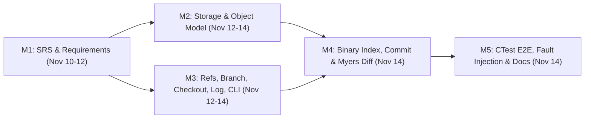

# Project Plan, Schedule & Risk Management

**Authors:** Bharat, Tejasv Lata, Sarthak  
**Baseline Reference:** [SRS.md](file:///Users/tejasv/Code/SE/Project/BTS-Version-Control/docs/SRS.md) Appendix D (Item 4)

---

## 1. Team Member Responsibilities & RACI Matrix

| Member | Primary Module Ownership | Key Codebase & Documentation Deliverables |
| :--- | :--- | :--- |
| **Bharat** | Storage Engine & Object Model ([src/storage/](file:///Users/tejasv/Code/SE/Project/BTS-Version-Control/src/storage), [src/objects/](file:///Users/tejasv/Code/SE/Project/BTS-Version-Control/src/objects), [object_store_stub.cpp](file:///Users/tejasv/Code/SE/Project/BTS-Version-Control/src/core/object_store_stub.cpp)) | SHA-256 hashing (`OpenSSL EVP`), zlib level-1 compression, Blob/Tree/Commit serialization (`Appendix A`), atomic `0444` object writes, integrity verification (`REQ-OBJ-1`–`REQ-OBJ-4`, `SR-1`), `init`/`config` (`REQ-INIT-1`–`REQ-INIT-2`, `REQ-CFG-1`, `REQ-CFG-3`), `storage_tests` & `objects_tests` |
| **Tejasv Lata** | Staging Index, Diff Engine & Architecture/QA Lead ([index.cpp](file:///Users/tejasv/Code/SE/Project/BTS-Version-Control/src/core/index.cpp), [diff.cpp](file:///Users/tejasv/Code/SE/Project/BTS-Version-Control/src/core/diff.cpp)) | Binary index format with SHA-256 footer (`Appendix B`, `MNT-3`), `O_CREAT \| O_EXCL` `.lock` + `fsync` + atomic rename (`RR-1`, `RR-3`), `add` (`REQ-ADD-1`–`REQ-ADD-7`), `status` with `lstat` cache (`REQ-STAT-1`–`REQ-STAT-3`, `PR-2`), nested tree builder & `commit` (`REQ-CMT-1`–`REQ-CMT-5`, `REQ-CFG-2`), Myers $O(ND)$ unified `diff` (`REQ-DIF-1`–`REQ-DIF-3`), SRS v0.3, [architecture.md](file:///Users/tejasv/Code/SE/Project/BTS-Version-Control/docs/architecture.md), [requirement-analysis.md](file:///Users/tejasv/Code/SE/Project/BTS-Version-Control/docs/requirement-analysis.md), [test-plan-and-report.md](file:///Users/tejasv/Code/SE/Project/BTS-Version-Control/docs/test-plan-and-report.md), [maintenance.md](file:///Users/tejasv/Code/SE/Project/BTS-Version-Control/docs/maintenance.md), and [scripts/benchmark.py](file:///Users/tejasv/Code/SE/Project/BTS-Version-Control/scripts/benchmark.py) |
| **Sarthak** | Reference Manager & CLI/Porcelain ([refs.cpp](file:///Users/tejasv/Code/SE/Project/BTS-Version-Control/src/core/refs.cpp), [src/commands/](file:///Users/tejasv/Code/SE/Project/BTS-Version-Control/src/commands), [main.cpp](file:///Users/tejasv/Code/SE/Project/BTS-Version-Control/src/main.cpp)) | `HEAD` & branch ref management (`REQ-BRN-1`–`REQ-BRN-5`), branch name validation (`REQ-BRN-4`), atomic checkout & overwrite protection (`REQ-CHK-1`–`REQ-CHK-4`), commit DAG traversal & collision-widening `abbreviate_hash` (`REQ-LOG-1`–`REQ-LOG-4`), CLI routing & exit status contract (`REQ-ERR-1`–`REQ-ERR-4`) |

### RACI Matrix (`R` = Responsible, `A` = Accountable, `C` = Consulted, `I` = Informed)

| Activity / Artifact | Bharat | Tejasv Lata | Sarthak |
| :--- | :---: | :---: | :---: |
| SRS v0.1–v0.3 & Requirement Analysis | C | **A / R** | C |
| Storage Layer (`hash`, `compress`, `ObjectStore`) & Object Formats | **A / R** | C | I |
| Reference Manager, Branch, Checkout, Log & CLI Router | I | C | **A / R** |
| Binary Staging Index, `add`, `status`, `commit` & Myers `diff` | C | **A / R** | C |
| CMake Build Integration & E2E / `SIGKILL` Fault-Injection Testing | C | **R** | **A** |
| Performance Benchmarking (`PR-1`, `PR-2`) & Maintenance Guide | I | **A / R** | C |

---

## 2. Development Schedule & Milestones

The project followed an incremental milestone workflow combining parallel module development on feature branches with continuous integration via GitHub Pull Requests (`PR #6` Reference/CLI, `PR #7` Storage/Object Model, final Index/Diff & QA integration).

### Milestone Dependency Flow

### Detailed Schedule & Deliverables

| Milestone | Target Window | Actual Completion | Scope & Exit Criteria | Owner(s) | Status |
| :--- | :--- | :--- | :--- | :--- | :--- |
| **M1: Requirements & Architecture** | Nov 10 – Nov 12, 2026 | Nov 12, 2026 | IEEE Std 830 SRS v0.1–v0.3, on-disk formats (Appendices A & B), requirement IDs & verification matrix | All | Completed |
| **M2: Storage & Object Model (`PR #7`)** | Nov 12 – Nov 14, 2026 | Nov 14, 2026 | SHA-256 (`EVP`), zlib level-1 compression, Blob/Tree/Commit serialization, `storage_tests` & `objects_tests` passing | Bharat | Completed |
| **M3: Ref Manager, CLI & Porcelain (`PR #6`)** | Nov 12 – Nov 14, 2026 | Nov 14, 2026 | `refs`, `branch`, `checkout`, `log`, `cli` dispatcher, `test_refs`, `test_branch`, `test_checkout`, `test_log`, `test_cli` passing | Sarthak | Completed |
| **M4: Index, Commit & Diff Integration** | Nov 13 – Nov 14, 2026 | Nov 14, 2026 | `"BTSI"` v1 binary index, `add` (`100644`/`100755`/`120000`), `status` `lstat` cache, tree builder & `commit`, Myers `diff`, exit `3` wiring | Tejasv Lata | Completed |
| **M5: Verification, Benchmarking & SE Docs** | Nov 14, 2026 | Nov 14, 2026 | Full CMake/CTest suite (`test_system_e2e` + `SIGKILL` fault injection, 100% passing), Release `PR-1`/`PR-2` benchmarks, UML, Requirement Analysis, QA & Maintenance docs | All | Completed |

---

## 3. Effort Allocation Summary

| Phase | Estimated Share | Key Activities |
| :--- | :---: | :--- |
| Requirements Engineering & UML Modeling | ~18% | Stakeholder analysis, use cases, IEEE 830 SRS v0.1–v0.3, Mermaid UML diagrams |
| Core & Command Implementation | ~44% | Storage, object model, binary index, tree builder, Myers diff, refs, checkout, log, CLI validation |
| Automated Testing & Fault Injection | ~24% | GoogleTest suites (unit, integration, E2E, `fork`+`SIGKILL` atomicity), Release benchmark script |
| Quality Assurance & Lifecycle Docs | ~14% | CMake integration, ADRs, SQA mapping, ISO/IEC 14764 maintenance playbook |

---

## 4. Risk Management Register

| Risk ID | Risk Description | Likelihood | Impact | Mitigation Strategy | Contingency / Resolution |
| :--- | :--- | :---: | :---: | :--- | :--- |
| **R-01** | Parallel interface drift between Storage/Objects (`PR #7`) and Core callers | Medium | High | Fixed header contracts (`bts/object_store.h`, `bts/refs.h`) early; unified SHA-256 + zlib headers behind `object_store_stub.cpp` facade | Schedule consolidation documented in [maintenance.md](file:///Users/tejasv/Code/SE/Project/BTS-Version-Control/docs/maintenance.md) Section 4.1 |
| **R-02** | Partial index or ref corruption on crash (`RR-1`) | Medium | Critical | Mandatory `O_CREAT \| O_EXCL` lock acquisition, full write, `fsync()`, and atomic `rename()` | Documented stale lock cleanup runbook; verified via `SIGKILL` child fault-injection test |
| **R-03** | Subtree mode formatting differences (`40000` vs `040000`) breaking `checkout` recursion | Medium | High | Explicit tree parser normalization (`mode == 40000 \|\| mode == 040000` / octal strings) and nested tree E2E tests | Fixed in [checkout.cpp](file:///Users/tejasv/Code/SE/Project/BTS-Version-Control/src/commands/checkout.cpp) and covered by `NestedTreesDetachedCommitAndCheckoutRestore` |
| **R-04** | OpenSSL 3 / GoogleTest discovery failing across macOS & Linux toolchains | Low | Medium | Added Homebrew prefix hints in [CMakeLists.txt](file:///Users/tejasv/Code/SE/Project/BTS-Version-Control/CMakeLists.txt) and guarded GNU/Clang `<9` `stdc++fs` linkage | Explicit toolchain prerequisites and build flags documented in [test-plan-and-report.md](file:///Users/tejasv/Code/SE/Project/BTS-Version-Control/docs/test-plan-and-report.md) |
| **R-05** | Performance degradation on `1,000+` files due to debug builds or missing `lstat` cache (`PR-1`, `PR-2`) | Medium | Medium | Zlib level-1 compression, cached `(mtime, size, mode)` short-circuiting, Release benchmark verification | Automated regression measurement via [scripts/benchmark.py](file:///Users/tejasv/Code/SE/Project/BTS-Version-Control/scripts/benchmark.py) |
| **R-06** | Silent acceptance of malformed CLI flags masking scripting bugs (`REQ-ERR-2`) | Low | Medium | Centralized strict flag/arity validation in `cli_main` and `cmd_branch` returning exit `2` | Verified via `CliTest.Cli_MalformedFlagsAndExtraArgsExit2` |
