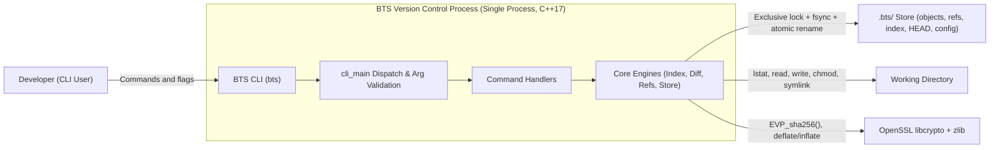
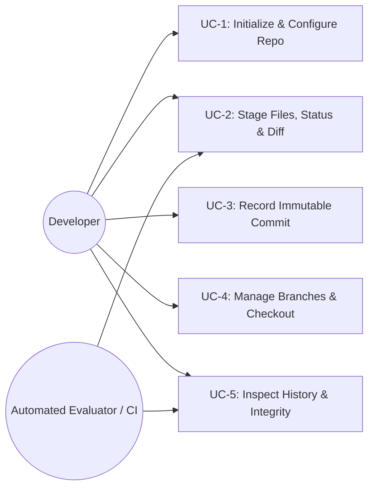

# Requirement Analysis & Use Case Specification

**Project:** BTS Version Control System  
**Authors:** Bharat, Tejasv Lata, Sarthak  
**Baseline Reference:** [SRS.md](file:///Users/tejasv/Code/SE/Project/BTS-Version-Control/docs/SRS.md) (Version 0.3)

---

## 1. Stakeholder Identification & Analysis

BTS targets local deterministic version control in an academic and solo-developer C++17 environment. Every requirement in [SRS.md](file:///Users/tejasv/Code/SE/Project/BTS-Version-Control/docs/SRS.md) maps to concrete stakeholder needs.

| Stakeholder | Category | Interest / Influence | Primary Goals & Expectations | Key Traced Requirements |
| :--- | :--- | :--- | :--- | :--- |
| **Individual Developer / Student** | Primary End User | High Interest / High Influence | Familiar Git-like CLI (`init`, `add`, `status`, `commit`, `branch`, `checkout`, `log`, `diff`), clear error messages, sub-second responsiveness, zero silent data loss on crashes. | `REQ-INIT-*`, `REQ-ADD-*`, `REQ-STA-*`, `REQ-CMT-*`, `REQ-BRN-*`, `REQ-CHK-*`, `REQ-DIF-*`, `PR-1`, `PR-2`, `USR-1` |
| **Course Evaluator / Auditor** | Reviewer / Assessor | High Interest / High Influence | Traceable adherence to IEEE 830 SRS principles, verifiable object/index formats (Appendices A–C), strict SHA-256 tamper detection, comprehensive unit/integration/system evidence. | `SR-1`, `RR-2`, `REQ-ERR-3`, Section 4 Verification Matrix |
| **Module Maintainer (Bharat, Tejasv, Sarthak)** | Internal Developers | High Interest / High Influence | Clean layer boundaries so Storage, Objects, Index/Diff, Refs, and CLI can be tested independently without circular dependencies or cross-module breakage. | `MNT-1`, `MNT-2`, `MNT-3`, `PO-1`, `PO-2` |
| **CI / Toolchain Operator** | Environment Stakeholder | Low Interest / Medium Influence | Standard CMake + C++17 build, deterministic exit codes (`0`, `1`, `2`, `3`), zero external Git runtime delegation. | `REQ-ERR-1..4`, Section 2.1.4 constraints |

### Prioritization Rationale (`E` / `D` / `O`)

Requirements in [SRS.md](file:///Users/tejasv/Code/SE/Project/BTS-Version-Control/docs/SRS.md) follow a three-tier priority discipline matching Section 1.3 scope boundaries:

- **Essential (`E` — Mandatory for v0.1 Release):** Atomic content-addressed SHA-256 object store (`SR-1`, `RR-2`), lock-protected binary staging index (`RR-1`, `REQ-ADD-*`), branch/HEAD ref management (`REQ-BRN-*`), commit/checkout/log (`REQ-CMT-*`, `REQ-CHK-*`, `REQ-LOG-*`), working-tree Myers diff (`REQ-DIF-*`), and deterministic error exit codes (`REQ-ERR-1..4`).
- **Desirable (`D` — Quality & Usability Enablers):** `lstat` cache short-circuiting (`REQ-STA-2`, `PR-2`), `abbreviate_hash` dynamic collision widening (`REQ-LOG-3`), cross-platform macOS/Linux support (`PO-1`, `PO-2`).
- **Optional / Explicitly Deferred (`O` — Future Scope):** Packfiles/delta storage, three-way merge/rebase, remote HTTP/SSH transport (`clone`/`push`/`pull`), `.btsignore`, and global `~/.btsconfig`. Deferring these preserved strict focus on correctness and POSIX crash atomicity.

---

## 2. System Boundary & Domain Constraints

### Constraint Analysis

1. **Zero Git Delegation Constraint:** BTS MUST execute every hashing, compression, index serialization, diff, and tree-traversal step natively in C++17 (`OpenSSL::Crypto` + `ZLIB::ZLIB`), never spawning `git`.
2. **Repository Isolation Constraint:** All metadata resides exclusively inside `<repo>/.bts/`; no global user config (`~/.btsconfig`) is read or mutated.
3. **Corruption Fail-Closed Guarantee (`SR-1`, `REQ-ERR-3`):** On every read from `.bts/objects/` or `.bts/index`, integrity digests are recomputed; mismatches throw `IntegrityException` or `IndexIntegrityException` and exit with code `3`.
4. **Workspace Overwrite & Lock Safety (`REQ-CHK-2`, `RR-3`):** BTS refuses branch/commit switches that would clobber uncommitted tracked edits or colliding untracked files, and aborts when active `*.lock` files exist.

---

## 3. Functional & Non-Functional Classification Summary

| Dimension | Count in SRS v0.3 | Core Focus |
| :--- | :---: | :--- |
| **Functional Requirements (`REQ-*`)** | **42** | `INIT` (2), `CFG` (3), `ADD` (4), `STA` (2), `CMT` (4), `LOG` (3), `BRN` (5), `CHK` (3), `DIF` (4), `ERR` (4), plus internal Storage (`SHA-256`, `zlib`), Object (`Blob`/`Tree`/`Commit`), and `Ref` invariants. |
| **Performance Requirements (`PR-*`)** | **2** | `PR-1` (stage + commit 1,000 files / ~20 MB in `< 3.0 s`), `PR-2` (clean `status` on 5,000 files in `< 200 ms`). |
| **Reliability Requirements (`RR-*`)** | **3** | `RR-1` (POSIX atomic lock + write + `fsync` + `rename` crash safety), `RR-2` (read-only immutable `0444` object verification), `RR-3` (`O_CREAT \| O_EXCL` single-writer exclusivity). |
| **Security, Portability, Maintainability, Usability** | **7** | `SR-1` (cryptographic hash verification), `PO-1..2` (POSIX portability & standard CMake C++17), `MNT-1..3` (documented codebase, modular CLI/core, versioned index schema), `USR-1` (`--help`, actionable errors). |

---

## 4. Detailed Use Case Model

### UC-1: Initialize and Configure Repository

- **Primary Actor:** Developer
- **Goal:** Create a clean `.bts/` repository and record author identity for commits.
- **Preconditions:** Target directory is writable (or can be created) and does not already contain `.bts/`.
- **Main Success Flow:**
  1. Developer executes `bts init [<dir>]`.
  2. BTS creates `.bts/objects/`, `.bts/refs/heads/`, empty `.bts/index` (empty v1 `"BTSI"` index semantics), `.bts/HEAD` containing `ref: refs/heads/main\n`, and empty `.bts/config` (`REQ-INIT-1`).
  3. Developer sets `bts config user.name "<Name>"` and `bts config user.email "<email>"` (`REQ-CFG-1`, `REQ-CFG-2`).
  4. BTS atomically writes `[user]` entries into `.bts/config` and returns exit code `0`.
- **Alternative / Exception Flows:**
  - *A1 (`.bts/` already exists):* `bts init` prints an error to `stderr` without overwriting existing state and exits `1` (`REQ-INIT-2`).
  - *E1 (Extra/unknown flags):* CLI parser rejects malformed arguments to `stderr` and exits `2` (`REQ-ERR-2`).
- **Postconditions:** Repository is ready to accept `bts add` and `bts commit`.

### UC-2: Stage Working Tree Changes, Inspect Status, and Compute Diff

- **Primary Actor:** Developer
- **Goal:** Stage regular files/executables/symlinks and verify staged vs unstaged differences before committing.
- **Preconditions:** Valid `.bts/` repository exists in current directory or an ancestor (`REQ-ERR-1`).
- **Main Success Flow:**
  1. Developer invokes `bts add <path>...`.
  2. BTS traverses non-`.bts` directories lexicographically, reads regular files or symlink targets via `lstat`/`read_symlink`, detects executable mode `100755` vs `100644` vs `120000`, writes content-addressed `blob` objects (`0444`), and atomically replaces `.bts/index` (`REQ-ADD-1..3`, `RR-1`).
  3. Developer invokes `bts status`; BTS walks the working tree and skips re-hashing unchanged files whose `(mtime, size, mode)` match cached `.bts/index` entries (`REQ-STA-2`, `PR-2`).
  4. Developer invokes `bts diff`; BTS compares tracked index entries against working tree using Myers $O(ND)$ algorithm and outputs unified hunks with 3 context lines (`REQ-DIF-1..4`).
- **Alternative / Exception Flows:**
  - *A1 (Missing file path in `bts add`):* Reports error to `stderr`, leaves `.bts/index` unmodified, exits `1` (`REQ-ADD-4`).
  - *A2 (Binary file containing NUL byte in `bts diff`):* Emits `Binary files differ` instead of line hunks (`REQ-DIF-3`).
  - *E1 (Lock file present or index tampering):* Aborts cleanly (`exit 1` for lock contention `RR-3`, `exit 3` for SHA-256 footer mismatch `IndexIntegrityException`).
- **Postconditions:** `.bts/index` accurately mirrors intended snapshot state without mutating `HEAD`.

### UC-3: Record Immutable Commit Snapshot

- **Primary Actor:** Developer
- **Goal:** Persist the currently staged `.bts/index` as a hierarchical `tree` + signed-by-author `commit` and advance the current branch.
- **Preconditions:** Valid `.bts/` repo; `user.name` and `user.email` configured (`REQ-CFG-3`); index contains changes vs `HEAD` tree (or initial commit non-empty).
- **Main Success Flow:**
  1. Developer runs `bts commit -m "<message>"`.
  2. BTS deserializes and SHA-256-verifies `.bts/index`.
  3. `build_trees_from_index` recursively builds sorted `tree` objects (`40000` for subdirectories, sorted bytewise per Appendix A, `REQ-CMT-1`).
  4. BTS builds a `commit` payload with `tree`, optional `parent`, `author <Name> <email> <epoch> <tz>`, and message, compresses at zlib level 1, stores read-only `0444`, and atomically updates `refs/heads/<branch>` or detached `HEAD` (`REQ-CMT-2..3`).
- **Alternative / Exception Flows:**
  - *E1 (Missing `-m` or extra flags):* CLI rejects with exit `2` (`REQ-ERR-2`).
  - *E2 (Unconfigured author / nothing to commit / empty message):* Aborts without creating commit object and returns exit `1` (`REQ-CMT-4`, `REQ-CFG-3`).
- **Postconditions:** New immutable commit is reachable from `HEAD` and displays in `bts log`.

### UC-4: Manage Branches and Switch Commits Safely

- **Primary Actor:** Developer
- **Goal:** Create, list, delete, or check out branches and historical commit prefixes without data loss.
- **Preconditions:** At least one commit exists before branching or checking out a commit/branch (`REQ-BRN-5`).
- **Main Success Flow:**
  1. Developer runs `bts branch` (lists sorted branches with `* <current>`), `bts branch <name>` (creates ref pointing to `HEAD`), or `bts branch -d <name>` (deletes non-current branch) (`REQ-BRN-1..4`).
  2. Developer runs `bts checkout <target>`; BTS resolves branch names first, or resolves 4–64-char hex commit prefixes (`REQ-CHK-3`).
  3. Safety preflight checks both local tracked modifications and untracked path collisions against the target tree (`REQ-CHK-2`) plus `.lock` absence (`RR-3`).
  4. BTS deletes obsolete tracked files, writes target files (restoring `0755` executables and symlinks), updates `.bts/index` with `lstat` cache metadata, and atomically updates `.bts/HEAD` (`REQ-CHK-1`).
- **Alternative / Exception Flows:**
  - *E1 (Overwrite risk — modified tracked file or colliding untracked file):* Refuses switch before modifying working tree or `HEAD`, prints error to `stderr`, exits `1` (`REQ-CHK-2`).
  - *E2 (Ambiguous hex prefix `< 4` chars or multiple matches):* Rejects switch and lists matching full hashes (`REQ-CHK-3`).
- **Postconditions:** Working directory, `.bts/index`, and `.bts/HEAD` coherently reflect the checked-out commit.

### UC-5: Inspect History and Detect Repository Corruption

- **Primary Actor:** Developer / Evaluator
- **Goal:** Traverse parent chains from `HEAD` chronologically and fail-closed if storage tampering is detected.
- **Preconditions:** Valid `.bts/` repo.
- **Main Success Flow:**
  1. Developer runs `bts log` or `bts log --oneline`.
  2. BTS walks first-parent pointers from `resolve_head(repo)` back to root commit (`REQ-LOG-1`).
  3. Every commit read recomputes zlib decompression + `SHA-256("commit <size>\0" + body)` (`RR-2`, `SR-1`).
  4. In `--oneline` mode, `abbreviate_hash` prints the shortest unique prefix (`min 7` chars, widening dynamically on prefix collisions, `REQ-LOG-3`).
- **Exception Flows:**
  - *E1 (Unborn branch — no commits yet):* Prints fatal error to `stderr` and exits `1` (`REQ-LOG-1`).
  - *E2 (Bit-rot or forged object/index file):* `IntegrityException` or `IndexIntegrityException` is caught in `cli_main`, printing diagnostics to `stderr` and terminating with exit code `3` (`REQ-ERR-3`).
- **Postconditions:** Output matches verified immutable commit graph; repository state remains read-only.
